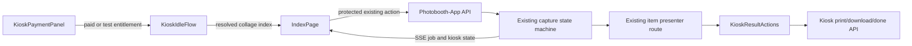

# Motif Moments Design System

## Direction

Motif Moments is an original Korean self-photo-studio experience built from editorial spacing, warm paper, pastel frame accents, crisp black typography, subtle printed texture, and small geometric sticker details. It does not copy Life Four Cuts branding, characters, logos, or trade dress.

## Brand language

- Product name: **Motif Moments**.
- Tagline: **Make it a motif. Keep the memory.**
- Use title case for the product name and sentence case for the tagline.
- The approved Motif Moments mark is the rounded black double-M symbol with its small blush accent. Use the large mark on attract or sign-in surfaces and the small mark beside the Inter wordmark in compact headers. Keep the symbol's transparent background and proportions intact.
- Guest states remain task-first: brand language supports payment, frame choice, capture, and delivery without replacing actionable status copy.

The payment state, camera, and finished collage remain the visual focus. Decoration never competes with money, countdown, capture, or the primary action.

## Durable visual rules

| Token | Value | Use |
|---|---:|---|
| Paper | `#F7F3EB` | Main background and print field |
| Ink | `#171717` | Text, focus, and strong marks |
| Blush | `#F4B8C2` | Four Strip ×2 accent |
| Butter | `#F4D77A` | Butter Grid accent |
| Mint | `#BFD8C2` | Mint and Six Moments accents |
| Lavender | `#C8BCE8` | Scrapbook and Eight Story accents |
| White | `#FFFDFA` | Photo/card surface |
| Danger | `#A93737` | Guest-recoverable errors |

- Reuse the bundled Inter variable font and local assets only.
- Ink-on-Paper is the standard text pairing; pastel colors are surfaces, not body text.
- Guest radii stay 12–16 px with one soft offset shadow.
- Minimum touch target is 56 px, including portaled dialog controls.
- Transitions last 160–240 ms. The capture cue is the only dominant animation: `10…2`, one 2.4-second smile animation, then its static final frame for 0.3 seconds before shutter.
- `prefers-reduced-motion` removes nonessential motion.

## Guest screen contract

### Payment / Attract

Landscape editorial split: the configured session price (₱200 by default) and accepted-note guidance at left; live remaining balance, 90-second partial-credit timer, and readiness at right. There is no Tap to start. Hidden five-tap operator access remains in the top-right corner.

### Frame selection and confirmation

Six actual previews appear in a 3×2 grid. Selecting a preview opens an accessible confirmation Dialog. Starting stays busy until SSE enters counting; failure exposes Retry and Back.

### Capture

The existing PreviewStream and CountdownTimer fill the screen. The backend supplies the 10-second display duration plus cue timing and does not begin capture until the 11.7-second timer completes. A restrained HUD shows `Photo n of 4`, `Photo n of 6`, or `Photo n of 8`. Processing reads `Making your photo…`.

### Result

Item-presenter mode places the portrait collage at left and Print, QR, Retake, and Done at right. Print and retake are mutually exclusive entitlements. The QR dialog polls the kiosk download endpoint until rclone confirms the public object, then displays a direct forced-download Supabase URL. Normal gallery browsing remains unchanged.

## Architecture

- `IndexPage.vue` is the thin orchestration surface.
- `KioskPaymentPanel.vue` owns payment, readiness, and partial-credit presentation.
- `KioskOperatorDialog.vue` owns password verification, test grants, void recovery, and admin entry.
- `KioskIdleFlow.vue` owns Frames, Confirm, and Starting after entitlement.
- `KioskCaptureHud.vue` reads the existing job model; it does not control capture.
- `KioskResultActions.vue` owns guest-safe print, QR, retake, and done controls.
- The existing Pinia store carries kiosk SSE state. Backend capture remains the only workflow state machine; SQLite is authoritative for payment and delivery entitlements.

## Tailwind and Quasar boundary

- Tailwind v4 runs through Quasar’s Vite plugin list.
- Theme and utilities use the `tw:` prefix and omit Preflight.
- Guest surfaces are scoped beneath `.kiosk-shell`.
- `components.json` is shadcn-vue metadata; `quasar.config.ts` remains the only Vite authority.
