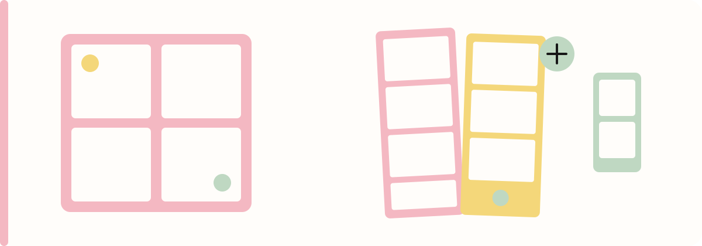
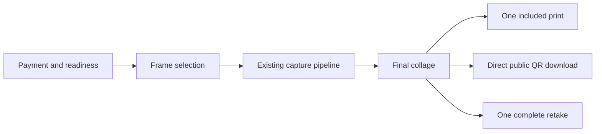

<p align="center">
  
</p>

<h1 align="center">Motif Moments</h1>

<p align="center">
  <strong>Make it a motif. Keep the memory.</strong><br />
  An offline-first, touch-friendly paid photo booth with a Korean self-photo-studio feel.
</p>

<p align="center">
  <a href="PRODUCT.md">Product</a> ·
  <a href="DESIGN.md">Design system</a> ·
  <a href="KIOSK_SETUP.md">Commissioning guide</a>
</p>

## Make the moment tangible

Motif Moments extends [Photobooth-App](https://github.com/photobooth-app/photobooth-app) with a focused guest journey, curated portrait collages, backend-authoritative payment entitlements, one included print, and direct Supabase QR downloads.

The interface combines a warm white canvas with Blush, Butter, and Mint accents. Editorial typography and actual frame previews keep the experience expressive without getting in the way of payment, capture, or delivery.

> [!IMPORTANT]
> The project is in commissioning mode. Paid operation remains disabled until the bill acceptor is electrically qualified, the default admin password is changed, and camera, printer, disk, and customer-storage checks all pass.

## Guest journey

```text
Insert the configured price (₱200 default) → choose a frame → confirm → capture → review → print / QR when available / retake / done
```

- Accepts configured ₱50, ₱100, and ₱200 notes; exact payment is recommended.
- Supports uninterrupted 4-, 6-, and 8-photo sessions with `10…2`, a 2.4-second smile cue, and a 0.3-second static hold before shutter.
- Produces a 1200 × 1800 portrait collage with approximately 4:3 photo windows.
- Includes one complete retake and one print, enforced by the backend.
- Keeps final kiosk results locally for seven days.
- Provides a password-protected, camera-only test mode for commissioning.

## Curated frames

| Guest frame | Captures | Composition |
|---|---:|---|
| Four Strip ×2 | 4 | Two matching 2 × 6 strips |
| Butter Grid | 4 | Two-by-two grid |
| Mint Editorial | 4 | One hero and three supporting windows |
| Lavender Scrapbook | 4 | Four rotated windows |
| Six Moments | 6 | Two-by-three grid |
| Eight Story | 8 | Two-by-four grid |

## System shape



The existing Photobooth-App state machine remains authoritative for camera and collage work. A SQLite kiosk session records credit, capture reservation, retake usage, print usage, results, and recovery state. Vue receives live readiness and entitlement updates through the existing SSE connection.

## Technology

| Layer | Foundation |
|---|---|
| Guest frontend | Vue 3, Quasar, Pinia, Tailwind CSS, shadcn-vue |
| Booth backend | Photobooth-App, Python, FastAPI, SQLAlchemy, SQLite |
| Camera and output | Existing Photobooth-App capture, collage, gallery, and print services |
| Cloud delivery | Supabase public Storage, S3-compatible rclone upload, cleanup Edge Function |
| Delivery contract | Direct forced-download URLs after confirmed upload; seven-day deletion |

## Workspace

```text
photobooth/
├── photobooth-app/       Python backend and built frontend
├── photobooth-frontend/  Vue guest and administration frontend
├── supabase/             Public bucket, cleanup function, and Cron example
├── config/               Placeholder-only rclone and synchronizer examples
├── PRODUCT.md            Product behavior and boundaries
├── DESIGN.md             Brand and interface system
└── KIOSK_SETUP.md        Commissioning and hardware qualification
```

`photobooth-data/` contains local runtime state. Only the curated PNG overlays in
`photobooth-data/userdata/kiosk/frames/` are versioned; customer photos, configuration,
credentials, databases, logs, and caches remain ignored. `ptbth/` is the ignored local
Python virtual environment.

## Setup guide

### First setup on a Windows booth PC

Install these prerequisites:

- Git for Windows, including Git Bash.
- Python 3.11 or newer, with **Add Python to PATH** enabled.

Clone Motif Moments and run the bootstrap from Git Bash:

```bash
git clone https://github.com/Gio-Padua/MotifMemories.git
cd MotifMemories
bash setup.sh
```

The bootstrap creates `ptbth/`, installs this repository's modified `photobooth-app/`
as an editable package, creates the runtime directories, and installs the six kiosk
collage actions on a new setup. It is safe to run again: an existing configuration,
database, credentials, and customer media are preserved.

> [!WARNING]
> Do not run `pip install photobooth-app`. That command installs the unmodified PyPI
> release instead of the Motif Moments backend in this repository.

### Start the booth

Run the backend from its runtime-data directory:

```bash
cd photobooth-data
../ptbth/Scripts/python.exe -m photobooth
```

The installed launcher is equivalent:

```bash
cd photobooth-data
../ptbth/Scripts/photobooth.exe
```

Open `http://localhost:8000` and keep the backend terminal running. Stop the server with
`Ctrl+C`. The committed production frontend is already bundled with the backend, so a
normal booth PC does not need Node.js.

### Update or repair an installation

After pulling repository changes, rerun:

```bash
bash setup.sh
```

Before moving an existing booth or making major configuration changes, stop the backend
and back up `photobooth-data/config/` and `photobooth-data/database/database.sqlite`.
Never commit those files. Supabase credentials belong only in the ignored
`photobooth-data/config/rclone.conf`; see [KIOSK_SETUP.md](KIOSK_SETUP.md).

If setup reports the wrong Python version, install Python 3.11 or newer and reopen Git
Bash. If the backend imports from the wrong location, verify:

```bash
ptbth/Scripts/python.exe -m pip show photobooth-app
```

`Editable project location` must point to this clone's `photobooth-app` directory.

### Frontend development

Node.js is needed only when editing the Vue frontend. Start it in a second Git Bash
terminal while the backend is running:

```bash
cd photobooth-frontend
npm install
npm run dev
```

The backend normally runs on port `8000`; the Quasar development server proxies API requests from port `9000`.

Verify a frontend change with:

```bash
npm test
npm run typecheck
npm run lint:check
npm run build
```

The production build is written into `photobooth-app/src/web/frontend/`.

## Commissioning

Start with [KIOSK_SETUP.md](KIOSK_SETUP.md). It covers operator access, test sessions, payment policy, Supabase delivery, public-media retention, and the TB74 electrical qualification gate.

Never connect a bill validator directly to PC USB or low-voltage GPIO. Machine-learning banknote recognition may be advisory, but it must never grant credit.

## Brand palette

| Token | Value | Role |
|---|---|---|
| White | `#FFFDFA` | Primary canvas and photo surface |
| Blush | `#F4B8C2` | Four-strip accent |
| Butter | `#F4D77A` | Selection and grid accent |
| Mint | `#BFD8C2` | Editorial and six-photo accent |
| Ink | `#171717` | Typography, focus, and controls |

The detailed visual rules live in [DESIGN.md](DESIGN.md).

## Upstream foundation

Motif Moments builds on the open-source [Photobooth-App](https://github.com/photobooth-app/photobooth-app) backend and Vue frontend. Preserve the upstream copyright and MIT license notices when distributing modified copies.
